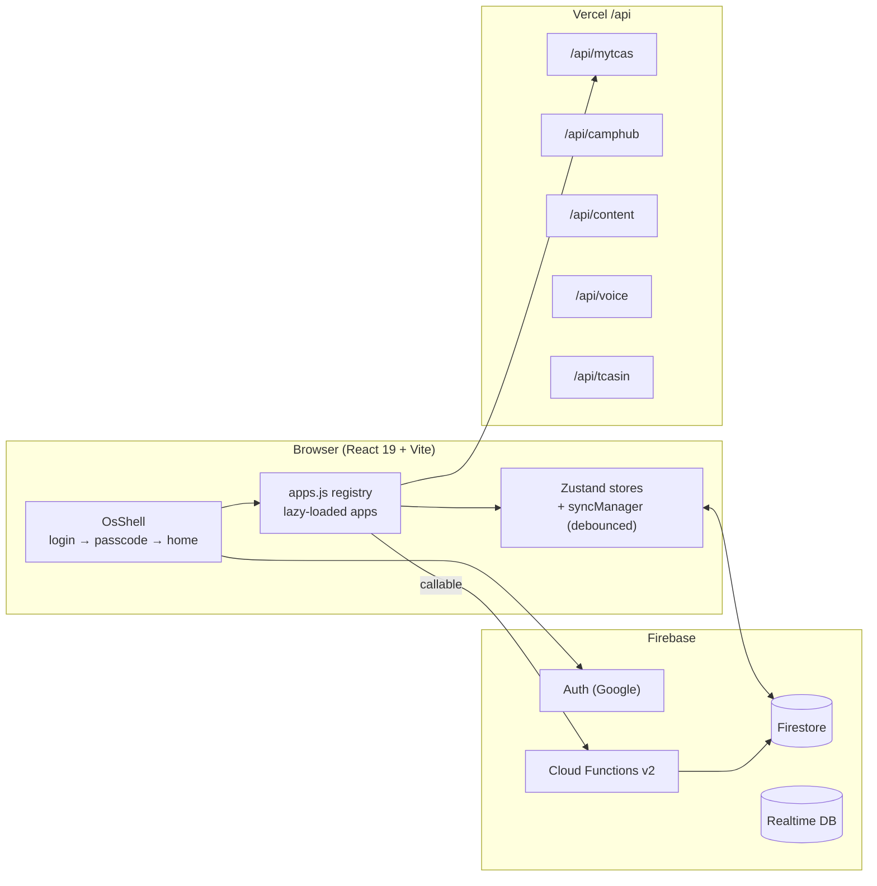

<div align="center">

# ❤️ I LOVE TCAS

**ระบบปฏิบัติการสำหรับคนเตรียมสอบ TCAS**
ล็อกอินด้วย Google ตั้งรหัสผ่านเครื่อง แล้วเข้าหน้า Home ที่มีแอปวางแผน อ่านหนังสือ และคุยกับเลขา AI อยู่ในที่เดียว


</div>

---

## 1. แอปนี้คืออะไร

I LOVE TCAS ถูกออกแบบใหม่ทั้งหมดให้เป็น **OS บนเว็บ** ที่หน้าตาเหมือนมือถือหรือแท็บเล็ต เปิดที่ [ilovetcas.com](https://ilovetcas.com) แล้วเจอลำดับนี้

```
Login with Google → รหัสผ่านเครื่อง 6 หลัก → Home (ไอคอนแอป นาฬิกา วอลเปเปอร์) → เปิดแอปเป็นหน้าต่าง
```

แอปรุ่นก่อน OS (เลือก MBTI → อาชีพ → มหาวิทยาลัย แล้วเข้าเกม Phaser พร้อมงาน ทักษะ โซเชียล) ยังอยู่ในโค้ดแต่ไม่ใช่หน้าแรกอีกแล้ว ส่วนที่ OS ยังใช้อยู่คือ **ห้องอ่านหนังสือ** (เกม Phaser ที่ `/home`) ซึ่งแอป Reading เปิดในหน้าต่าง และ **Open House** (`/openhouse`) รายการสถานะฟีเจอร์รุ่นเก่าอยู่ที่ [`docs/legacy-feature-status.md`](docs/legacy-feature-status.md) (เอกสารประวัติ ไม่ใช่สถานะปัจจุบัน)

หลักการของ OS นี้มีสามข้อ

- **ทุกอย่างเป็นแอป** เพิ่มฟีเจอร์ใหม่ = เพิ่มแอปหนึ่งตัวใน registry ที่เดียว
- **ผู้ใช้เลือกเองว่าจะมีแอปอะไร** แอปติดตั้งและถอนผ่าน Store ได้ ยกเว้น Store กับ Settings
- **ใช้เปิดทิ้งไว้ข้างหนังสือได้** ข้อมูลบันทึกในบัญชีอัตโนมัติ ไม่ต้องกดเซฟ

---

## 2. แอปใน OS

### แอปในตัว (ลบไม่ได้)

| แอป | หน้าที่ |
|---|---|
| **Store** | ค้นหาและติดตั้งแอป แบ่งหมวด มีหน้ารายละเอียดและรีวิว |
| **Settings** | โปรไฟล์ วอลเปเปอร์ เสียง ภาษา AI รหัสผ่านเครื่อง ความเป็นส่วนตัว |

### แอปที่ติดตั้งให้ตั้งแต่แรก (ถอนได้)

| แอป | หน้าที่ |
|---|---|
| **Goal** | เลือกมหาวิทยาลัย คณะ สาขา ตั้งวันสอบ ดูคะแนนที่ต้องใช้ แล้วให้ AI วางแผนอ่านหนังสือรายวัน |
| **Habit** | ปฏิทินแผนรายวัน to do list นิสัยประจำวัน และสถิติต่อเนื่อง |
| **Reading** | ห้องอ่านหนังสือในเกม Phaser: ห้องของตัวเอง ตั้งเวลาโฟกัสให้ต้นไม้โต ร้านค้า ตกแต่งห้อง เวลาที่อ่านเชื่อมกับ Habit และมีอันดับ (เปิดหน้า `/home` ในหน้าต่าง) |
| **Community** | ฟีดโพสต์ของคนเตรียมสอบ ถูกใจ ค้นหา โปรไฟล์ |
| **Chat** | ห้องแชตตามคณะ/สาขา ห้องรวม และหาเพื่อน |
| **Mood** | เช็กอินความรู้สึกวันละครั้ง ดูความถี่แบบตาราง GitHub |
| **Block** | วางแผนเส้นทางเป็นบล็อกต่อกัน (Roadmap เดิม) แชร์ลิงก์ได้ |
| **Secretary** | เลขา AI "พี่ใจดี" ตามงาน จัดตาราง แชตพิมพ์ และโทรคุยด้วยเสียง |
| **Calendar** | ปฏิทิน TCAS70 รวมกับงานใน Habit |
| **Open House** | เดินสำรวจมหาวิทยาลัยจำลอง ดูสาขาและเส้นทางเข้า ใช้ได้โดยไม่ต้องล็อกอิน |
| **Report** | ขอแอปหรือเว็บที่อยากให้มี และโหวตคำขอของคนอื่น |

### แอปใน Store

เว็บภายนอกที่เปิดในหน้าต่างของ OS (ถ้าเว็บไม่ให้ฝังจะเปิดแท็บใหม่) และเว็บรับสมัครของมหาวิทยาลัยทุกแห่งใน myTCAS หมวดทั้งหมดอยู่ใน `CATEGORIES` ของ [`src/os/apps.js`](src/os/apps.js)

---

## 3. ผู้ใช้เห็นอะไร

- **รหัสผ่านเครื่อง** เป็น PIN 6 หลักต่ออุปกรณ์ เก็บเป็น hash (SHA-256 ผสม uid) ใน localStorage ไม่ส่งขึ้น Firestore รีเฟรชหน้าแล้วล็อกใหม่ ลืมรหัสต้องออกจากระบบแล้วล็อกอิน Google ใหม่
- **Home** แบ่งหน้าได้ ลากสลับตำแหน่งไอคอน รวมแอปเป็นโฟลเดอร์ วางไฟล์ได้ (สูงสุด 20 ไฟล์ ไฟล์ละไม่เกิน 5 MB เก็บในเครื่อง) กดค้างที่ไอคอนเพื่อดูรายละเอียด กดค้างที่ว่างเพื่อเปลี่ยนวอลเปเปอร์ รองรับวอลเปเปอร์ที่อัปโหลดเอง และเลือกรูปโปรไฟล์ได้
- **หน้าต่างแอป** เดสก์ท็อปลากได้ ขยาย/ย่อได้ ย่อลงแถบงาน มือถือและแท็บเล็ตเปิดเต็มจอ
- **คู่มือ** ทัวร์ต้อนรับเปิดอัตโนมัติครั้งแรกบนเครื่อง ปุ่ม `?` เปิดซ้ำได้ และทุกหน้าต่างมี "วิธีใช้" ของแอปนั้น
- **เลย์เอาต์** มือถือ/แท็บเล็ตมีแถบสถานะด้านบน ส่วนเดสก์ท็อปมีแถบงานด้านล่าง
- **ข้อมูลของแอป** เป้าหมาย แผน นิสัย และหนังสือ เก็บใน `users/{uid}.os` ผ่าน `useLifeStore` และซิงก์แบบหน่วงเวลา ส่วนวอลเปเปอร์ ลำดับไอคอน และไฟล์เป็นของเครื่องนั้น (`useOsStore`)
- **Splash** แต่ละแอปมีหน้าเปิดแอปเป็นภาพพิกเซลของตัวเอง

---

## 4. สถาปัตยกรรม



- **OS shell** อยู่ใน [`src/os/`](src/os/) `OsShell.jsx` เป็น state machine ตัวเดียว: loading → login → consent → passcode → home
- **App registry** [`src/os/apps.js`](src/os/apps.js) เป็นที่เดียวที่เพิ่มแอป แต่ละแอปโหลดแบบ lazy จาก `src/os/apps/XxxApp.jsx`
- **แอปแบบฝังหน้าเดิม** Reading และ Open House เป็น iframe ของหน้าเดิม (`/home`, `/openhouse`) บนโดเมนเดียวกัน store ของเกมจึงแยกจาก store ของ OS
- **Backend แยกสองฝั่ง** ข้อมูลภายนอก (myTCAS, Camphub) ผ่าน Vercel `/api/*` ส่วนเงินและตรรกะธุรกิจอยู่ใน Firebase Functions
- **เขียน Firestore แบบหน่วงเวลา** ผ่าน `src/lib/syncManager.js` เท่านั้น และพาธทั้งหมดมาจาก `src/lib/db.js`
- **เว็บแยกโดเมน** `ilovetcas.com` และ `app.ilovetcas.com` เปิด OS ที่ `/` ส่วนบทความ (`/blog/*`, `/articles`) และ Open House ยังอยู่บนโดเมนหลัก ดู [ADR 0029](docs/adr/0029-apex-homepage-is-the-os-shell.md)

ศัพท์ที่ใช้ในโค้ดอยู่ใน [`CONTEXT.md`](CONTEXT.md) กติกาของโปรเจกต์อยู่ใน [`CLAUDE.md`](CLAUDE.md)

---

## 5. เพิ่มแอปใหม่

1. สร้าง `src/os/apps/MyApp.jsx` โดย default export เป็น React component (รับ `{ onOpenApp }`)
2. เพิ่ม object ใน `RAW_APPS` ของ `src/os/apps.js`

```js
{
  id: 'my-app',                 // kebab-case ไม่ซ้ำ
  name: 'My App',
  tagline: 'บรรทัดเดียวสำหรับ Store',
  description: 'คำอธิบายยาวสำหรับหน้ารายละเอียด',
  Icon: Sparkles,               // lucide-react
  tone: 'var(--color-brand)',
  installable: true,            // แสดงใน Store
  defaultInstalled: false,      // true = ติดตั้งให้ทุกเครื่องตอนแรก
  category: 'study',
  features: ['ข้อ 1', 'ข้อ 2'],
  load: () => import('./apps/MyApp'),
}
```

3. ใส่ไอคอน/ภาพ splash ใน `public/assets/os/apps/` และ `public/assets/os/splash/` (ถ้ามี) แล้วรัน `npm test` เพราะ `apps.test.js` ตรวจ registry

---

## 6. เริ่มต้นใช้งาน

```bash
npm install
cp .env.example .env        # ใส่ค่า VITE_FIREBASE_* และ VITE_GEMINI_API_KEY
npm run dev                 # http://localhost:5173
```

| คำสั่ง | ใช้ทำอะไร |
|---|---|
| `npm run dev` | เปิด Vite dev server |
| `npm test` | รันเทสต์ Vitest |
| `npm run test:rules:emu` | ทดสอบกฎ Firestore, RTDB, Storage บน emulator |
| `npm run lint` | ESLint |
| `npm run build` | build และ prerender หน้า SEO |
| `npm run refresh-tcas-snapshot` | อัปเดตสแนปช็อตข้อมูล myTCAS สำรอง |
| `npm run refresh-openhouse-index` | อัปเดตดัชนี Open House |
| `npm run promo:all` | สร้างวิดีโอโปรโมต (ดู `promo/`) |

<details>
<summary>ตัวแปรสภาพแวดล้อม</summary>

```env
VITE_FIREBASE_API_KEY
VITE_FIREBASE_AUTH_DOMAIN
VITE_FIREBASE_PROJECT_ID
VITE_FIREBASE_STORAGE_BUCKET
VITE_FIREBASE_MESSAGING_SENDER_ID
VITE_FIREBASE_APP_ID
VITE_FIREBASE_DATABASE_URL
VITE_GEMINI_API_KEY
VITE_GOOGLE_MAPS_KEY
```

ถ้า deploy ขึ้นโดเมนใหม่ ต้องเพิ่มโดเมนใน Firebase Authentication → Authorized domains ไม่งั้น Google sign-in จะขึ้น "domain not authorized"
</details>

---

## 7. โครงสร้างโปรเจกต์

```
src/
├── os/           OS shell, app registry, Home, Store, passcode และแอปทั้งหมด (os/apps/)
├── components/   UI ที่ใช้ร่วม แผงแอดมิน Studio
├── game/         Phaser (ห้องอ่านหนังสือ, Open House)
├── room/         ห้องส่วนตัวและการวางของ (ใช้ในแอป Reading)
├── lib/          db.js, syncManager.js, firestoreListener.js
├── services/     sessionBootstrap, aiTasks, aiJourney
├── stores/       Zustand
├── pages/        หน้าตาม route (Admin, Studio, Auth, Privacy ฯลฯ)
└── data/         ข้อมูลคงที่ (tcas70.js, universityApps.js)
api/              Vercel serverless (myTCAS, TCAS Starter, Camphub, content, voice/Retell)
functions/        Firebase Cloud Functions และตรรกะบริสุทธิ์ที่เทสต์ได้
scripts/          สคริปต์ครั้งเดียว (อัปโหลดแอสเซต สแนปช็อต)
promo/            วิดีโอโปรโมตและสคริปต์ผลิต
ai-handoff/       ใบสั่งงานภาพ/ข้อความกับ ChatGPT
test/rules/       ทดสอบกฎความปลอดภัย
docs/adr/         บันทึกการตัดสินใจสถาปัตยกรรม
```

---

## 8. วิธีพัฒนา

- **เขียนการตัดสินใจก่อนโค้ด** ทุกการเปลี่ยนสถาปัตยกรรมมี ADR ใน [`docs/adr/`](docs/adr/)
- **คำสั่งงาน** `/lv-create` → `/lv-preview` → `/lv-push` → `/lv-merge` สำหรับฟีเจอร์ และ `/lv-edit` → `/lv-push` สำหรับบั๊ก ดู [ADR 0028](docs/adr/0028-lv-commands-replace-korawit-skills.md)
- **ข้อจำกัดบังคับ** JavaScript + JSX ล้วน (ไม่มี TypeScript) โทเคน Tailwind v4 อยู่ใน `src/index.css` ที่เดียว ห้ามเขียน Firestore ตรงโดยไม่ผ่าน `syncManager` และ `db.js`
- **ธีม** Soft Pixel ดู [`design.md`](design.md)

---

## 9. PDPA และความเป็นส่วนตัว

แอปมีหน้ายินยอมก่อนใช้งาน นโยบายความเป็นส่วนตัว และข้อกำหนดการใช้งานภาษาไทย ผู้ใช้ลบบัญชีได้เองผ่านฟังก์ชัน `deleteMyAccount` ข้อความทางกฎหมายยังเป็นร่างที่ต้องให้ทนายตรวจก่อนเปิดกว้าง แอปโทรด้วยเสียงของ Secretary ต้องได้รับความยินยอมก่อนใช้ทุกครั้ง

---

## เครดิต

ภาพพิกเซลส่วนใหญ่มาจาก Sprout Lands ของ [Cup Nooble](https://cupnooble.itch.io/) ข้อมูลหลักสูตรและรอบรับสมัครมาจาก [myTCAS](https://www.mytcas.com/) ของ ทปอ. และข่าวค่ายมาจาก [Camphub](https://camphub.in.th/)

> **License: All Rights Reserved** ซอร์สโค้ดเปิดให้ดูเพื่อเป็นผลงานและอ้างอิงเท่านั้น ห้ามคัดลอก ดัดแปลง แจกจ่าย หรือนำไปใช้โดยไม่ได้รับอนุญาตเป็นลายลักษณ์อักษร ดู [LICENSE](LICENSE)
