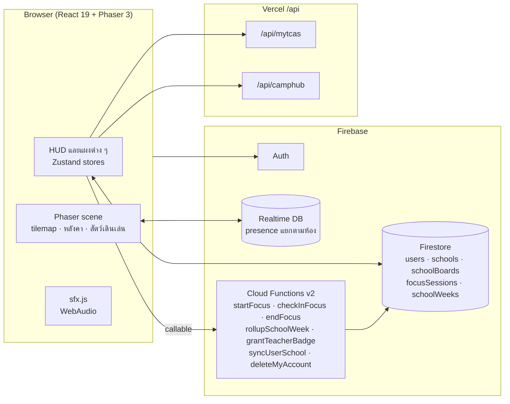

<div align="center">

# ❤️ I LOVE TCAS

**โรงเรียนพิกเซลที่นักเรียนไทยเปิดทิ้งไว้ได้ทั้งวัน**
วางแผน TCAS, อ่านหนังสือในห้องสมุดเดียวกับเพื่อน และดูว่าโรงเรียนตัวเองอยู่อันดับไหนของสัปดาห์


</div>

---

## เอกสารฉบับนี้เล่าอะไร

README นี้เขียนให้คนที่เพิ่งเปิดโปรเจกต์อ่านแล้วเข้าใจสามเรื่อง คือระบบนี้แก้ปัญหาอะไร ตัดสินใจออกแบบด้วยหลักคิดแบบไหน และโค้ดชิ้นสำคัญแต่ละชิ้นทำงานอย่างไร ส่วนวิธีติดตั้งอยู่ท้ายเอกสาร หากต้องการรายการฟีเจอร์รุ่นก่อนโลกโรงเรียน ดูได้ที่ [`docs/legacy-feature-status.md`](docs/legacy-feature-status.md)

---

## 1. ปัญหาที่อยากแก้

นักเรียนมัธยมไทยมีเครื่องมือเตรียมสอบให้เลือกมากพออยู่แล้ว ทั้งตารางอ่านหนังสือ ปฏิทินสอบ และเว็บค้นหาคณะ สิ่งที่ขาดคือเหตุผลให้กลับมาเปิดทุกวัน และความรู้สึกว่าเพื่อนร่วมโรงเรียนกำลังทำเรื่องเดียวกันอยู่ใกล้ ๆ

I LOVE TCAS จึงทำเป็นโลกเกมแนวอบอุ่น มีแผนที่โรงเรียนหนึ่งแผนที่ซึ่งทุกโรงเรียนใช้ร่วมกัน แต่แต่ละโรงเรียนได้ห้องของตัวเอง นักเรียนเดินเข้าห้องสมุด นั่งโต๊ะ กดเริ่มโฟกัส แล้วปล่อยหน้าจอไว้ ระบบนับเวลาให้เฉพาะช่วงที่ยืนยันตัวตนจริง และเอาเวลานั้นไปจัดอันดับโรงเรียนรายสัปดาห์

ตัวเกมไม่ได้พยายามแทนเครื่องมือเดิม ห้องแนะแนวเปิดหน้า Roadmap อยู่แล้ว บอร์ดโรงอาหารแสดงปฏิทิน TCAS70 พร้อมนับถอยหลัง และบอร์ดประกวดดึงข่าวค่ายจาก Camphub อาคารแต่ละหลังเป็นแค่ประตูไปหาของที่มีอยู่

---

## 2. หลักการออกแบบ

หลักห้าข้อนี้เขียนลง [ADR 0018](docs/adr/0018-school-community-world.md) ก่อนเริ่มเขียนโค้ด และทุกครั้งที่ลังเลระหว่างสองทางเลือก เราย้อนกลับมาถามว่าข้อไหนในนี้ตัดสินให้ได้

**เซิร์ฟเวอร์เป็นผู้ตัดสินทุกอย่างที่มีมูลค่า** XP เวลาโฟกัส และอันดับ ไม่เคยผ่านมือไคลเอนต์ ไคลเอนต์ทำได้แค่ขอให้เซิร์ฟเวอร์เปิดเซสชัน เช็กอิน และปิดเซสชัน เวลาที่ใช้คำนวณมาจากนาฬิกาฝั่งเซิร์ฟเวอร์เท่านั้น ถ้าให้ไคลเอนต์ส่งตัวเลขมาเอง ใครเปิดเครื่องมือนักพัฒนาก็ได้ที่หนึ่งในห้านาที

**ความหนาแน่นสำคัญกว่าความกว้าง** ห้องที่มีคนเดินอยู่สองคนดูเหมือนเกมร้าง โรงเรียนจะได้ห้องของตัวเองต่อเมื่อมีสมาชิกลงทะเบียนครบ 30 คน ก่อนหน้านั้นทุกคนอยู่ห้องรวมด้วยกัน ห้องหนึ่งรับได้ 50 คน เต็มแล้วแตกเป็นห้องที่สอง สาม และต่อไปตามต้องการ

**ออกแบบให้เปิดทิ้งไว้ได้** ผู้ใช้ที่ไม่ได้ขยับเมาส์ควรเสียค่าเซิร์ฟเวอร์น้อยมาก เกมจึงลดความถี่การส่งตำแหน่งเมื่อว่าง ลด FPS ของ Phaser เมื่อซ่อนแท็บ และตั้งเป้าให้ผู้ใช้ที่ idle ใช้ข้อมูลไม่เกินราว 1 KB ต่อวินาที ตัวเลขและวิธีวัดอยู่ใน [`docs/plans/afk-cost-notes.md`](docs/plans/afk-cost-notes.md)

**ยืมของเดิมมาเป็นประตู** ระบบใหม่ที่ต้องสร้างจริงมีสองอย่างคือโฟกัสกับอันดับ ที่เหลือเชื่อมเข้ากับสิ่งที่ผู้ใช้มีอยู่ ช่องแชร์ข้อสอบเก่าเลื่อนออกไปก่อน เพราะติดเรื่องลิขสิทธิ์และภาระดูแลเนื้อหา

**ผู้เยาว์มาก่อนฟีเจอร์** ในห้องโรงเรียนไม่มีแชตพิมพ์อิสระ ผู้เล่นสื่อสารด้วยอีโมจิสำเร็จรูป ชื่อที่แสดงคือชื่อเล่นกับรูปตัวละคร ไม่ใช่ชื่อจริง ระบบรายงานและบล็อกต้องมีก่อนจะเพิ่มแชตข้อความ ซึ่งตอนนี้ยังไม่มี จึงยังไม่มีแชตข้อความ

---

## 3. ภาพรวมสถาปัตยกรรม



ข้อมูลภายนอกอย่าง myTCAS และ Camphub ผ่าน Vercel `/api/*` ส่วนอะไรที่เกี่ยวกับเงินหรือตรรกะทางธุรกิจอยู่ใน Firebase Functions กติกานี้เขียนไว้ใน [`CLAUDE.md`](CLAUDE.md) และถือเป็นข้อบังคับของโปรเจกต์ ศัพท์ที่ใช้ในโค้ดและเอกสารอ้างอิงจาก [`CONTEXT.md`](CONTEXT.md)

---

## 4. อ่านโค้ดส่วนสำคัญ

โค้ดด้านล่างตัดมาจากไฟล์จริง จุดที่ข้ามไปเขียนเป็น `// ...` และระบุพาธไว้ให้เปิดดูต่อได้

### 4.1 นับเวลาโฟกัสโดยไม่เชื่อไคลเอนต์ · `functions/focusMath.js`

คณิตศาสตร์ของการตรวจเวลาแยกออกมาเป็นไฟล์ที่ไม่เรียก Firebase เลย จึงทดสอบด้วย Vitest ธรรมดาได้ เวลาจะนับก็ต่อเมื่อช่วงระหว่างหลักฐานการอยู่หน้าจอสองครั้งติดกัน (เริ่ม เช็กอิน จบ) สั้นพอให้เชื่อได้

```js
const CHECKIN_WINDOW_MS = 35 * 60 * 1000   // client prompts every ~25 min; 10 min of slack
const MIN_GAP_MS = 10 * 1000               // ignore call spam closer together than this
const DAILY_CAP_MS = 8 * 60 * 60 * 1000

function settleSegment({ lastCheckInAt, nowMs, dailyUsedMs = 0 }) {
  const gap = nowMs - lastCheckInAt
  if (!(gap >= MIN_GAP_MS)) {
    return { creditedMs: 0, tooSoon: true, lapsed: false, capped: false }
  }
  const lapsed = gap > CHECKIN_WINDOW_MS
  const raw = lapsed ? 0 : gap
  const remaining = Math.max(0, DAILY_CAP_MS - dailyUsedMs)
  const creditedMs = Math.min(raw, remaining)
  return { creditedMs, tooSoon: false, lapsed, capped: raw > remaining }
}
```

อ่านแล้วเห็นสามกรณี เรียกถี่เกินไปไม่ได้เวลา ห่างเกินหน้าต่างเช็กอินไม่ได้เวลาเพราะช่วงนั้นไม่มีหลักฐานว่าอยู่ และวันหนึ่งนับไม่เกินแปดชั่วโมง ผลที่ตามมาคือเวลาที่นับได้ไม่มีทางเกินเวลาจริง ต่อให้ไคลเอนต์ยิงฟังก์ชันรัว ๆ

XP คิดแบบปัดเศษจากยอดรวม ไม่ได้ปัดทีละครั้ง จึงไม่มีเศษหายระหว่างการเช็กอิน

```js
function xpDelta(beforeMs, afterMs) {
  return Math.floor(afterMs / MS_PER_XP) - Math.floor(beforeMs / MS_PER_XP)
}
```

### 4.2 ธุรกรรมเดียวจบทั้งเวลา XP และบันทึกเซสชัน · `functions/index.js`

`settleActive` เป็นฟังก์ชันที่ทั้งเช็กอินและจบเซสชันเรียกใช้ร่วมกัน อ่านข้อมูลทั้งหมดก่อน เขียนทีหลัง ตามกติกาของธุรกรรม Firestore

```js
return db.runTransaction(async (tx) => {
  const [activeSnap, dailySnap] = await Promise.all([tx.get(activeRef), tx.get(dailyRef)])
  if (!activeSnap.exists) throw new HttpsError('failed-precondition', 'NO_ACTIVE_SESSION')
  const active = activeSnap.data()
  const dailyUsed = Number(dailySnap.data()?.verifiedMs ?? 0)

  const seg = settleSegment({ lastCheckInAt: active.lastCheckInAt, nowMs, dailyUsedMs: dailyUsed })
  const before = Number(active.verifiedMs ?? 0)
  const after = before + seg.creditedMs
  // ...คูณ XP ด้วยบัฟของกลุ่มบุคลิกภาพ (ไม่แตะเวลาที่ใช้จัดอันดับ)
  if (seg.creditedMs > 0) {
    tx.set(dailyRef, { uid, day, schoolId: active.schoolId ?? null,
      verifiedMs: dailyUsed + seg.creditedMs }, { merge: true })
  }
  if (xpGained > 0) {
    tx.set(userRef, { focusXp: admin.firestore.FieldValue.increment(xpGained) }, { merge: true })
  }
  // ...
})
```

บัฟจากกลุ่ม MBTI คูณเฉพาะ XP เวลาที่ยืนยันแล้วซึ่งเป็นฐานของอันดับไม่ถูกแตะ ใครได้บัฟก็ไม่ได้เปรียบในการจัดอันดับโรงเรียน

เซสชันที่ค้างนานเกินหน้าต่างเช็กอินจะปิดเป็น `lapsed` โดยไม่เพิ่มเวลา และเรียก `startFocus` ซ้ำจากแท็บอื่นแค่กลับเข้าเซสชันเดิม ไม่ได้เปิดใหม่ซ้อน

### 4.3 กฎ Firestore กันที่ปลายทาง · `firestore.rules`

ต่อให้ Functions ถูกเขียนผิด ชั้นกฎยังกันไว้อีกชั้น เอกสารโฟกัสทั้งสามประเภทไคลเอนต์เขียนไม่ได้เลย

```
match /focusActive/{uid} {
  allow read: if isSignedIn() && request.auth.uid == uid;
  allow write: if false;
}
match /focusDaily/{docId} {
  allow read: if isSignedIn() && resource.data.uid == request.auth.uid;
  allow write: if false;
}
```

Admin SDK ในฟังก์ชันข้ามกฎได้ จึงเขียนได้ ส่วนบอร์ดประกาศตรวจสิทธิ์ครูจาก custom claim ที่ฟังก์ชัน `grantTeacherBadge` ตั้งให้ ไม่ได้ดูจากฟิลด์ที่ผู้ใช้แก้เองได้

ฝั่ง Realtime Database ใช้กฎจำกัดว่าใครเข้าห้องโรงเรียนไหนได้ โดยอ่านจากโหนด `userSchool` ที่มีแต่ฟังก์ชันเขียน (`database.rules.json`)

```json
".read": "auth != null && (!$ownerUid.beginsWith('school:') ||
  $ownerUid.beginsWith('school:' + root.child('userSchool').child(auth.uid).val() + ':'))"
```

### 4.4 เลือกห้องและแตก shard · `src/lib/schoolRoom.js`

ห้องในเกมคือคู่ค่า (ownerUid, mapKey) ของ RTDB ห้องโรงเรียนจึงเป็นแค่ ownerUid สงวนบนแผนที่ `school_hub` เดียวกัน ไม่ต้องวาดแผนที่แยกให้แต่ละโรงเรียน

```js
export function resolveRoomBase({ schoolId, memberCount }) {
  if (typeof schoolId === 'string' && SAFE_ID.test(schoolId) && Number(memberCount) >= SCHOOL_ROOM_MIN_MEMBERS) {
    return { kind: 'school', base: `school:${schoolId}` }
  }
  return { kind: 'commons', base: 'commons' }
}

export function pickShard(counts, cap = ROOM_CAP) {
  const i = counts.findIndex((c) => c < cap)
  return i === -1 ? null : i + 1
}
```

ตัวอักษร `:` ไม่มีทางอยู่ใน place_id ของ Google กฎ RTDB จึงใช้ `school:{id}:` เป็นคำนำหน้าที่ไม่กำกวมได้ เพดาน 50 คนเป็นเพดานแบบหลวม เพราะกฎ RTDB นับจำนวนลูกไม่ได้ ถ้าสองคนเข้าพร้อมกันอาจเกินไปหนึ่งหรือสองคน ซึ่งยอมรับได้ และบันทึกไว้ในคอมเมนต์ต้นไฟล์

### 4.5 อันดับที่ไม่เข้าข้างโรงเรียนใหญ่ · `functions/leaderboardMath.js`

ตัวชี้วัดคือชั่วโมงที่ยืนยันแล้วเฉลี่ยต่อสมาชิกที่ลงทะเบียน โรงเรียนต้องมีนักเรียนอย่างน้อย 10 คนที่มีเวลาในสัปดาห์นั้นถึงจะถูกจัดอันดับ

```js
const members = Math.max(Number(info.memberCount) || 0, contributors)
out.push({
  schoolId, contributors, memberCount: members, totalMs: s.totalMs,
  avgHoursPerMember: Math.round((s.totalMs / MS_PER_HOUR / members) * 100) / 100,
})
```

หารด้วยจำนวนสมาชิกทั้งหมด ไม่ใช่จำนวนคนที่ขยัน โรงเรียนจะชนะได้ก็ต่อเมื่อพานักเรียนทั้งโรงเรียนมาอ่านหนังสือ บัญชีปลอมที่อ้างโรงเรียนมีแต่ทำให้ค่าเฉลี่ยต่ำลง สัปดาห์นับแบบ ISO ตามเวลาไทย เริ่มวันจันทร์ 00:00 ฟังก์ชัน `weekInfo` ในไฟล์เดียวกันคำนวณให้

### 4.6 เขียน Firestore แบบหน่วงเวลาที่เดียว · `src/lib/syncManager.js`

เดิมมีไฟล์ sync สามไฟล์ที่หน้าตาเกือบเหมือนกัน ต่างคนต่างถือตัวแปร timer และตัวป้องกันการเขียนย้อนกลับตอนโหลดข้อมูล ตอนนี้รวมเป็นโรงงาน `createFirestoreSync()` เดียว ส่วนที่แต่ละ store ต่างกันส่งเข้ามาเป็น callback

ตัวโรงงานรับพารามิเตอร์เหล่านี้ (สรุปจาก JSDoc ในไฟล์):

```js
// store, logName, toDoc(state), fromDoc(data), changed(state, prev),
// needsSeed(data), ref(uid), guard(state, uid), onStatus(status)
```

กติกาของโปรเจกต์คือห้ามเขียน Firestore ตรง ๆ ต้องผ่านตัวนี้ทุกครั้ง เพื่อให้การกดรัวไม่กลายเป็นการเขียนรัว

### 4.7 แมพที่สร้างจากสคริปต์และพิสูจน์ด้วยเทสต์ · `scripts/buildSchoolHub.mjs`

แผนที่ 56×41 ช่องไม่ได้วาดมือใน Tiled แต่สร้างจากสคริปต์ที่ให้ผลเหมือนเดิมทุกครั้ง ผลดีคือแก้ผังแล้วรันใหม่ได้ และเขียนเทสต์ตรวจแผนที่ได้ เทสต์ 24 ข้อทำ BFS จากจุดเกิดด้วยค่าการชนจริงของเกม เพื่อยืนยันว่าถึงทุกประตู โซน และที่นั่งอ่านหนังสือ ไม่มีทางเดินกว้างแค่หนึ่งช่อง และไฟล์ JSON บนดิสก์ตรงกับผลของสคริปต์

หลังคาตามแบบที่ Sprout Lands วาดไว้ คือชิ้นห้าแถวที่มีสันหลังคาเส้นเดียว แถวขอบล่างโปร่งบางส่วนเพราะตั้งใจให้ชายคาซ้อนลงบนผนังไม้ด้านหน้า

```js
function roof(L, b) {
  const { x, y, w, h } = b
  const top = y - 1
  const rows = h + 1                    // y-1 .. y+h-1
  const shift = b.roof ? ROOF_VARIANTS[b.roof] - WOODEN_HOUSE_FIRSTGID : 0
  // ridge sits a little differently per building so roofs do not read as copies
  const ridge = Math.min(rows - 3, Math.max(2, Math.floor((rows - 1) / 2) + (b.ridgeShift ?? 0)))
  for (let r = 0; r < rows; r++) {
    let set
    if (r === 0) set = [ROOF.TL, ROOF.T, ROOF.TR]
    else if (r === rows - 1) set = [ROOF.BL, ROOF.B, ROOF.BR]
    else if (r === ridge) set = [ROOF.ML, ROOF.M, ROOF.MR]
    else if (r < ridge) set = [ROOF.TL2, ROOF.T2, ROOF.TR2]
    else set = [ROOF.BL2, ROOF.B2, ROOF.BR2]
    // ...วางทีละคอลัมน์ เว้นช่องประตูกับทางเข้าห้องสมุด
  }
}
```

แพ็กมีหลังคาสีเดียว แต่โปรเจกต์ต้องการห้าหลังที่ไม่ซ้ำกัน ทางออกคือสลับพาเลตต์ตอนโหลดเกม ไม่ต้องเพิ่มไฟล์ภาพ ฟังก์ชัน `recolorPixel` ใน `src/utils/recolor.js` หมุนเฉดสีของแผ่น tileset แล้วสร้างเป็น texture ใหม่ชื่อ `Wooden House Roof blue` เป็นต้น

### 4.8 หลังคาจางลงเมื่อเดินเข้าไป · `src/game/worldScenes.js`

ชั้นหลังคาและยอดไม้วาดทับตัวละคร (depth 20 และ 21) ตัวละครจึงเดินอ้อมหลังต้นไม้ได้ พอเดินเข้าอาคาร หลังคาของอาคารนั้นหลังเดียวจะโปร่งลง

```js
const OVERHEAD_DEPTH = { Canopy: 20, Roof: 21 }
const ROOF_FADED_ALPHA = 0.12

_tickRoofs() {
  // ...ทำทุก 4 เฟรม
  const tx = Math.floor(this.player.x / this._mapScale / 16)
  const ty = Math.floor(this.player.y / this._mapScale / 16)
  const here = ty * this._roofMapW + tx
  for (const roof of this._roofs) {
    const target = roof.cells.has(here) ? ROOF_FADED_ALPHA : 1
    if (Math.abs(roof.alpha - target) < 0.01) continue
    roof.alpha += (target - roof.alpha) * 0.35
    for (const t of roof.tiles) t.alpha = roof.alpha
  }
}
```

`_initRoofs` ไล่แบ่งกระเบื้องหลังคาเป็นกลุ่มที่ติดกัน กลุ่มละหนึ่งอาคาร ไม่ต้องบอกเกมล่วงหน้าว่าอาคารอยู่ตรงไหน

### 4.9 เสียงที่สร้างจากโค้ดล้วน ๆ · `src/lib/sfx.js`

เสียงทุกเสียงเป็นโน้ตออสซิลเลเตอร์ไม่กี่ตัว ไม่มีไฟล์เสียง จึงไม่มีเรื่องลิขสิทธิ์ให้ต้องกังวล

```js
export const SOUNDS = {
  click:   [N(0, 740, 0.045, 0.45)],
  coin:    [N(0, 988, 0.07, 0.55), N(0.07, 1319, 0.22, 0.55)],
  levelup: [
    N(0, 523, 0.1), N(0.1, 659, 0.1), N(0.2, 784, 0.1), N(0.3, 1047, 0.12),
    N(0.45, 784, 0.08), N(0.53, 1047, 0.35),
  ],
}
```

เสียงเดียวกันถูกตัดทิ้งถ้าดังซ้ำภายใน 45 มิลลิวินาที ผู้ใช้ปิดเสียงหรือปรับระดับได้ และถ้าเบราว์เซอร์ไม่มี WebAudio ฟังก์ชันคืนค่า false เฉย ๆ ไม่ทำให้หน้าจอพัง เสียงฝนห้องสมุดเป็นนอยส์ที่กรองความถี่ แล้ววนซ้ำ

---

## 5. วิธีพัฒนา

**เขียนการตัดสินใจก่อนโค้ด** ทุกการเปลี่ยนสถาปัตยกรรมมี ADR ใน [`docs/adr/`](docs/adr/) ตั้งแต่ 0001 ถึง 0020 รูปแบบคือสถานะ บริบท การตัดสินใจ ทางเลือกที่พิจารณา และผลที่ตามมา โลกโรงเรียนอยู่ใน 0018 ธีมพิกเซลอยู่ใน 0019 และเสียงอยู่ใน 0020 พอย้อนมาอ่านทีหลังจะรู้ว่าทำไมถึงเลือกแบบนี้ ไม่ใช่แค่เห็นว่าโค้ดเป็นแบบนี้

**แยกตรรกะบริสุทธิ์ออกจาก I/O** ตัวคำนวณเวลาโฟกัส อันดับ การเลือกห้อง การตรวจสมาชิกโรงเรียน บัฟบุคลิกภาพ และสีหลังคา เป็นฟังก์ชันที่รับค่าแล้วคืนค่า ไม่แตะเครือข่ายหรือฐานข้อมูล จึงเทสต์ได้เร็วและเทสต์ขอบเขตได้ครบ ส่วนที่ต้องแตะ Firebase ถูกจำกัดให้บางที่สุด

**แบ่งงานตามเครื่องมือ** Claude Code รับงานวางแผน สคริปต์ เทสต์ กฎ Firestore และ Functions ส่วน Cursor รับงาน React และ Tailwind ลำดับงานคือวางแผนทีละไอเดีย แล้วลงมือเป็นช่วง ทดสอบ push และรายงาน บั๊กข้ามขั้นวางแผนไปแก้เลยแต่ต้องผ่านด่านทดสอบเดียวกัน รายละเอียดอยู่ใน [ADR 0017](docs/adr/0017-korawit-skills-executor-choice-and-ihateskill.md)

**ทดสอบในที่ที่ของจริงอยู่** กฎความปลอดภัยทดสอบกับ Firebase emulator ด้วยเทสต์กว่า 138 ข้อ ไม่ได้เทสต์ด้วย mock เพราะกฎที่ผ่านเฉพาะตอน mock ไม่มีความหมาย ส่วนแมพทดสอบด้วยค่าการชนจริง และหน้าตาตรวจด้วยตาในเบราว์เซอร์จริง

**ข้อจำกัดบังคับ** โปรเจกต์ใช้ JavaScript กับ JSX ล้วน ไม่มี TypeScript โทเคนสีของ Tailwind v4 อยู่ใน `src/index.css` ที่เดียว และพาธของ Firebase ต้องมาจาก `src/lib/db.js` เท่านั้น ห้ามเขียน `doc(db, 'collection', id)` กลางโค้ด

---

## 6. ธีมและ UI

ธีม Cozy Pixel RPG ใช้ UI pack ของ Sprout Lands ([ADR 0019](docs/adr/0019-cozy-pixel-rpg-theme.md)) สีทั้งหมดเป็นโทเคนใน `@theme` มีคลาสกลางอย่าง `.rpg-plank`, `.rpg-bar` และ `.rpg-btn-primary` ปุ่มบนจอจงใจให้น้อย ช่องเก็บของเป็นแถบแนวนอนล่างกลางจอแบบ Stardew เมนูลัดรวมเป็นปุ่มเดียวที่กดแล้วขึ้นรายการ และแผงที่เด้งขึ้นมาลอยเหนือแถบเมนูล่างเสมอ หน้ารวมตัวอย่างสไตล์อยู่ที่ `/dev/ui` ซึ่งเปิดได้เฉพาะโหมดพัฒนา

---

## 7. ปฏิทิน TCAS70 และข้อมูลจริง

บอร์ดโรงอาหารขึ้นต้นด้วยการ์ดนับถอยหลังไปยังเหตุการณ์ถัดไปของระบบกลาง ข้อมูล 16 รายการอยู่ใน `src/data/tcas70.js` ตรวจเทียบจากสองแหล่งที่วันตรงกันทุกข้อ ทั้ง [PPTV HD36](https://www.pptvhd36.com/news/274111) และ [Dreamnest Hub](https://dreamnesthub.com/schedule) ข้อมูลชุดนี้ขึ้นเฉพาะตอนที่คอลเลกชัน `tcasEvents` ใน Firestore ยังว่าง พอแอดมินเพิ่มรายการเอง รายการของแอดมินจะมาแทนทั้งหมด

ปฏิทินนี้เป็นเพียงวันสำคัญของส่วนกลาง วันรับสมัคร Portfolio, Quota และรับตรงของแต่ละมหาวิทยาลัยต่างกันไป ผู้ใช้ต้องตรวจกับ [mytcas.com](https://www.mytcas.com/) ก่อนตัดสินใจเสมอ และข้อความนี้แนบไว้ทุกแถว

---

## 8. PDPA และความเป็นส่วนตัว

แอปมีหน้ายินยอมก่อนใช้งาน หน้านโยบายความเป็นส่วนตัว และข้อกำหนดการใช้งานภาษาไทย ผู้ใช้กดลบบัญชีได้เอง ฟังก์ชัน `deleteMyAccount` ลบข้อมูลทั้งหมดของผู้ใช้รวมถึงบันทึกโฟกัสด้วย ข้อความทางกฎหมายยังเป็นร่างที่ไม่ได้เขียนโดยนักกฎหมาย ต้องให้ทนายตรวจก่อนเปิดให้คนทั่วไปใช้

ปัญหาที่ยังไม่แก้และต้องแก้ก่อนเปิดกว้างคือเอกสาร `users/{uid}` ยังมีอีเมลอยู่ และผู้ใช้ที่ล็อกอินแล้วทุกคนอ่านได้ ทางแก้คือย้ายอีเมลออกจากเอกสารสาธารณะ

---

## 9. เริ่มต้นใช้งาน

```bash
npm install
cp .env.example .env        # ใส่ค่า VITE_FIREBASE_* และ VITE_GEMINI_API_KEY
npm run dev                 # http://localhost:5173
```

| คำสั่ง | ใช้ทำอะไร |
|---|---|
| `npm run dev` | เปิด Vite dev server |
| `npm test` | รันเทสต์ Vitest ทั้งหมด (ประมาณ 1,200 ข้อ) |
| `npm run test:rules:emu` | ทดสอบกฎ Firestore, RTDB และ Storage บน emulator |
| `node scripts/buildSchoolHub.mjs` | สร้าง `public/maps/school_hub.json` ใหม่ |
| `npm run build` | build และ prerender หน้า SEO |
| `npm run refresh-tcas-snapshot` | อัปเดตสแนปช็อตข้อมูล myTCAS สำรอง |

<details>
<summary>ตัวแปรสภาพแวดล้อม</summary>

```env
VITE_FIREBASE_API_KEY
VITE_FIREBASE_AUTH_DOMAIN
VITE_FIREBASE_PROJECT_ID
VITE_FIREBASE_STORAGE_BUCKET
VITE_FIREBASE_MESSAGING_SENDER_ID
VITE_FIREBASE_APP_ID
VITE_FIREBASE_DATABASE_URL
VITE_GEMINI_API_KEY
VITE_GOOGLE_MAPS_KEY
```
</details>

---

## 10. โครงสร้างโปรเจกต์

```
src/
├── components/   HUD, แผงต่าง ๆ, school/world (โฟกัส อันดับ บอร์ด), hud (เอฟเฟกต์ เลเวล)
├── game/         Phaser scenes และ asset manifest
├── lib/          db.js, presence.js, schoolRoom.js, sfx.js, syncManager.js
├── services/     schoolWorld, focus, leaderboard, consent, accountDeletion
├── stores/       Zustand
├── data/         tcas70.js, legalContent.js และข้อมูลคงที่อื่น
functions/        Cloud Functions และตรรกะบริสุทธิ์ที่เทสต์ได้ (focusMath, leaderboardMath)
api/              Vercel serverless (myTCAS, Camphub)
scripts/          buildSchoolHub.mjs, uploadAssets.mjs และสคริปต์ครั้งเดียวอื่น ๆ
test/rules/       ทดสอบกฎความปลอดภัย
docs/adr/         บันทึกการตัดสินใจสถาปัตยกรรม
```

---

## 11. สถานะและสิ่งที่ยังค้าง

โลกโรงเรียน โฟกัส อันดับ ป้ายครู ลบบัญชี ปฏิทิน TCAS70 ธีมพิกเซล และเสียง เขียนเสร็จ ทดสอบแล้ว และ deploy ขึ้นเว็บจริงแล้ว แต่ยังไม่ได้ทดสอบโฟกัสบนเว็บจริงจากผู้ใช้จริงสักรอบ

สิ่งที่ยังค้างมีสี่เรื่อง อีเมลที่รั่วอยู่ในเอกสารผู้ใช้ตามข้อ 8 ระบบรายงานและบล็อกซึ่งต้องมีก่อนแชตข้อความ การให้ทนายตรวจเอกสารทางกฎหมาย และ `schoolId` ซึ่งมาจากที่ผู้ใช้เลือกเองผ่าน Google Places ยังไม่มีการยืนยันว่าเป็นนักเรียนของโรงเรียนนั้นจริง ส่วนห้องสมุดแชร์ข้อสอบ แผนที่มหาวิทยาลัย และของตกแต่งตามฤดูกาลอยู่ในแผนถัดไป ยังไม่เริ่ม

---

## เครดิต

ภาพพิกเซลทั้งหมดมาจาก Sprout Lands ของ [Cup Nooble](https://cupnooble.itch.io/) ข้อมูลหลักสูตรและรอบรับสมัครมาจาก [myTCAS](https://www.mytcas.com/) ของ ทปอ. และข่าวค่ายกับการประกวดมาจาก [Camphub](https://camphub.in.th/)

> **License: All Rights Reserved** ซอร์สโค้ดเปิดให้ดูเพื่อเป็นผลงานและอ้างอิงเท่านั้น ห้ามคัดลอก ดัดแปลง แจกจ่าย หรือนำไปใช้โดยไม่ได้รับอนุญาตเป็นลายลักษณ์อักษร ดู [LICENSE](LICENSE)
