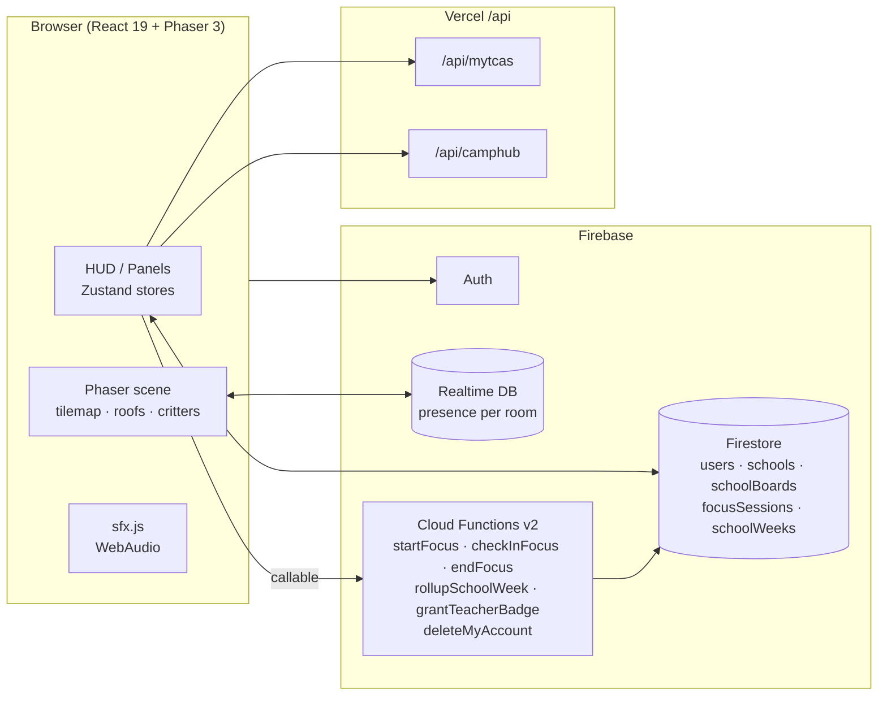

<div align="center">

# ❤️ I LOVE TCAS

### โรงเรียนพิกเซลที่นักเรียนไทย "เปิดทิ้งไว้ทั้งวัน" — วางแผน TCAS, โฟกัสอ่านหนังสือ และแข่งกันภูมิใจในโรงเรียนตัวเอง

*A cozy pixel-RPG school world for Thai students: plan your TCAS path, study in a shared library, and rank your school against others.*


</div>

---

## ✨ ทำไมถึงต่างจากแอปวางแผนเรียนทั่วไป

นักเรียนมัธยมไทยมีเครื่องมือเยอะ แต่ไม่มี **เหตุผลให้เปิดทิ้งไว้** และไม่มี **หลักฐานทางสังคมต่อโรงเรียน**
I LOVE TCAS เปลี่ยน "การเตรียมสอบ" ให้เป็นโลกเกมแสนอบอุ่นที่ทั้งโรงเรียนอยู่ร่วมกัน:

| | |
|---|---|
| 🏫 **โลกโรงเรียน (School World)** | แผนที่พิกเซลหนึ่งแผนที่ แต่ละโรงเรียนมีห้องของตัวเอง เดินเห็นเพื่อนแบบเรียลไทม์ — ห้องสมุด โรงอาหาร ห้องแนะแนว บอร์ดประกวด |
| ⏱ **Focus ที่ยืนยันโดยเซิร์ฟเวอร์** | นั่งโต๊ะอ่านหนังสือ ระบบเช็กอินทุก 25 นาที นับเฉพาะเวลาที่ยืนยันตัวเอง (สูงสุด 8 ชม./วัน) แค่เปิดแท็บทิ้งไว้ไม่ได้ XP |
| 🏆 **อันดับโรงเรียนรายสัปดาห์** | จัดอันดับด้วย *ชั่วโมงโฟกัสเฉลี่ยต่อสมาชิก* (ขั้นต่ำ 10 คน) โรงเรียนใหญ่จึงไม่ได้เปรียบเพราะจำนวนคน |
| 🎓 **ป้ายครู + ประกาศโรงเรียน** | ครูที่ได้รับการยืนยันโพสต์ประกาศบนบอร์ดโรงอาหารได้ (ตรวจด้วย custom claim ฝั่งเซิร์ฟเวอร์) |
| 📅 **ปฏิทิน TCAS70 จริง** | วันสำคัญของระบบกลาง ทปอ. พร้อมนับถอยหลังวันถัดไป และค้นหลักสูตร/รอบ/เกณฑ์คะแนนจาก myTCAS |
| 🧠 **MBTI → ความสามารถ** | 16 ชนิดบุคลิกจัดเป็น 4 กลุ่มอารมณ์ แต่ละกลุ่มมีบัฟเล็ก ๆ ตอนเลเวลอัป |
| 🔊 **เสียง + เอฟเฟกต์ 8-bit** | สร้างจาก WebAudio ทั้งหมด ไม่มีไฟล์เสียงให้ต้องขอลิขสิทธิ์ + เสียงฝนห้องสมุดยามค่ำ |

> **ออกแบบมาให้ตั้งทิ้งไว้ได้ (AFK-first):** presence แบบความถี่ต่ำ, ลด FPS ของเกมเมื่อไม่ขยับ/ซ่อนแท็บ, จำกัดห้องละ 50 คนแล้วแตก shard — งบประมาณเป้าหมาย < 1 KB/s ต่อผู้ใช้ที่ idle ([บันทึกต้นทุน](docs/plans/afk-cost-notes.md))

---

## 🗺 แผนที่โรงเรียน

สร้างจากสคริปต์ที่ให้ผลลัพธ์เหมือนเดิมทุกครั้ง ([`scripts/buildSchoolHub.mjs`](scripts/buildSchoolHub.mjs)) เป็น Tiled JSON 56×41 ช่อง ด้วย asset ของ **Sprout Lands** (Cup Nooble):

- 🏠 **5 อาคาร** หลังคาสีต่างกัน (ใช้ palette swap ตอนโหลด ไม่ต้องเพิ่มไฟล์ภาพ) — หลังคาจางลงเมื่อเดินเข้าไปข้างใน
- 🌳 ต้นไม้ที่เดิน "อ้อมหลัง" ได้ (ชั้น Canopy วาดทับตัวละคร), สนามหญ้า, แปลงดอกไม้, พุ่มไม้ตามหน้าอาคาร
- 🐄 วัวและไก่เดินเล่น, ป้ายชื่อสถานที่แผ่นสีครีม
- ✅ **เทสต์ 24 ข้อรับประกันว่าแมพเล่นได้จริง** — BFS จากจุดเกิดไปถึงทุกโซน/ประตู/ที่นั่ง, ไม่มีทางเดินแคบ 1 ช่อง, JSON บนดิสก์ตรงกับ generator

---

## 🧱 สถาปัตยกรรม



**หลักการสำคัญ**

- **Server-authoritative:** XP, เวลา Focus และอันดับเขียนได้เฉพาะ Cloud Functions — ฝั่งไคลเอนต์แก้ตัวเลขไม่ได้ ([ADR 0004](docs/adr/), [ADR 0018](docs/adr/0018-school-community-world.md))
- **ห้องโรงเรียนเปิดเมื่อมีสมาชิกครบ 30 คน** ไม่เช่นนั้นใช้ห้องรวม (`commons`) — ห้องว่างรู้สึกตาย ความหนาแน่นสำคัญกว่าความกว้าง
- **Dual backend:** ข้อมูลภายนอก → Vercel `/api/*`; ธุรกิจ/การเงิน → Firebase Functions
- **เขียน Firestore แบบ debounce เสมอ** ผ่าน `syncManager` ไม่เขียนตรง
- **ความปลอดภัยของผู้เยาว์:** ในห้องโรงเรียนไม่มีแชตข้อความอิสระ (อีโมจิสำเร็จรูปเท่านั้น) ไม่แสดงชื่อจริง

---

## 🛡 PDPA และความเป็นส่วนตัว

- ✔ หน้ายินยอม (ConsentGate) + หน้า Privacy / Terms ภาษาไทย
- ✔ **ปุ่มลบบัญชี** ที่ลบข้อมูลทั้งหมดผ่าน Cloud Function (`deleteMyAccount`)
- ✔ กฎ Firestore / RTDB ทดสอบด้วย emulator กว่า 138 เคส
- ⚠ ข้อความทางกฎหมายเป็นร่างโดยไม่ใช่นักกฎหมาย — **ต้องให้ทนายตรวจก่อนเปิดจริง** ([`docs/OWNER-TODO.md`](docs/OWNER-TODO.md))

---

## 🎨 ดีไซน์: Cozy Pixel RPG

ธีมกลางจากแพ็ก UI ของ Sprout Lands ([ADR 0019](docs/adr/0019-cozy-pixel-rpg-theme.md)) — โทเคนสีใน `@theme` ของ Tailwind v4, คลาส `.rpg-plank / .rpg-bar / .rpg-btn-primary`, HUD แบบเกม (ช่องเก็บของแนวนอนล่างกลางแบบ Stardew, เมนูปุ่มเดียว) และหน้าตัวอย่างสไตล์ที่ `/dev/ui` (โหมด dev เท่านั้น)

---

## 🚀 เริ่มต้นใช้งาน

```bash
npm install
cp .env.example .env        # ใส่ค่า VITE_FIREBASE_* และ VITE_GEMINI_API_KEY
npm run dev                 # http://localhost:5173
```

| คำสั่ง | ทำอะไร |
|---|---|
| `npm run dev` | Vite dev server |
| `npm test` | Vitest (jsdom) — ~1,200 เทสต์ |
| `npm run test:rules:emu` | ทดสอบ Firestore/RTDB/Storage rules ด้วย Firebase emulator |
| `node scripts/buildSchoolHub.mjs` | สร้างแผนที่ `public/maps/school_hub.json` ใหม่ |
| `npm run build` | build + prerender หน้า SEO |
| `npm run refresh-tcas-snapshot` | อัปเดตสแนปช็อตข้อมูล myTCAS สำรอง |

<details>
<summary>ตัวแปรสภาพแวดล้อม</summary>

```env
VITE_FIREBASE_API_KEY
VITE_FIREBASE_AUTH_DOMAIN
VITE_FIREBASE_PROJECT_ID
VITE_FIREBASE_STORAGE_BUCKET
VITE_FIREBASE_MESSAGING_SENDER_ID
VITE_FIREBASE_APP_ID
VITE_FIREBASE_DATABASE_URL
VITE_GEMINI_API_KEY
VITE_GOOGLE_MAPS_KEY
```
</details>

---

## 📁 โครงสร้างโปรเจกต์

```
src/
├── components/   HUD, panels, school/world (โฟกัส อันดับ บอร์ด), hud (เอฟเฟกต์/เลเวล)
├── game/         Phaser scenes, asset manifest
├── lib/          db.js (Firestore refs), presence.js, sfx.js, syncManager.js
├── services/     schoolWorld, focus, leaderboard, consent, accountDeletion
├── stores/       Zustand
├── data/         tcas70.js (ปฏิทิน TCAS70), legalContent.js, …
functions/        Cloud Functions + คณิตศาสตร์ล้วน ๆ ที่เทสต์ได้ (focusMath, leaderboardMath)
api/              Vercel serverless (myTCAS, Camphub)
scripts/          buildSchoolHub.mjs, uploadAssets.mjs, …
test/rules/       ทดสอบ security rules
docs/adr/         การตัดสินใจทางสถาปัตยกรรม (0001–0020)
```

เอกสารเพิ่มเติม: [`CONTEXT.md`](CONTEXT.md) (อภิธานและสถาปัตยกรรมฉบับหลัก) · [แผน MVP](docs/plans/2026-10-14-school-world-mvp.md) · [แผน Pilot](docs/plans/2026-10-14-school-world-pilot.md) · [รายการฟีเจอร์ฉบับเดิม](docs/legacy-feature-status.md)

---

## 🧪 คุณภาพ

- **1,200+ เทสต์** (Vitest + jsdom) + **138+ เทสต์ security rules** บน Firebase emulator
- ตรรกะสำคัญเป็นฟังก์ชันบริสุทธิ์แยกจาก I/O (focus, อันดับ, สมาชิกโรงเรียน, ป้ายครู, สีหลังคา) จึงเทสต์ได้ตรง ๆ
- แผนที่ถูก **พิสูจน์ด้วยเทสต์** ว่าทุกจุดไปถึงได้จริง

---

## 🗓 สถานะและสิ่งที่ยังไม่ทำ

| รายการ | สถานะ |
|---|---|
| โลกโรงเรียน, Focus, อันดับ, ป้ายครู, ลบบัญชี | ✅ เขียนและเทสต์แล้ว |
| ปฏิทิน TCAS70 + นับถอยหลัง | ✅ |
| ธีมพิกเซล + เสียง + เอฟเฟกต์ | ✅ |
| ซ่อนอีเมลจากเอกสาร `users/{uid}` ที่ทุกคนอ่านได้ | ⚠️ **ต้องแก้ก่อนเปิดจริง (PDPA)** |
| ระบบรายงาน/บล็อกผู้ใช้ | ⏳ ต้องมีก่อนเพิ่มแชตข้อความ |
| ห้องสมุดแชร์ข้อสอบ/ชีท | ⏳ เลื่อน (ลิขสิทธิ์ + การดูแลเนื้อหา) |
| แผนที่มหาวิทยาลัย, ของตกแต่งตามฤดูกาล | ⏳ ถัดไป |

---

## 🙏 เครดิต

- ศิลปะพิกเซล: **Sprout Lands** โดย [Cup Nooble](https://cupnooble.itch.io/)
- ข้อมูลหลักสูตรและรอบรับสมัคร: [myTCAS](https://www.mytcas.com/) (ทปอ.) · ปฏิทิน TCAS70 อ้างอิง [PPTV HD36](https://www.pptvhd36.com/news/274111) และ [Dreamnest Hub](https://dreamnesthub.com/schedule) — โปรดยืนยันกับ mytcas.com ก่อนตัดสินใจเสมอ
- ข่าวค่าย/ประกวด: [Camphub](https://camphub.in.th/)

---

> **⚠️ License — All Rights Reserved.** ซอร์สโค้ดเปิดให้ดูเพื่อเป็นผลงาน/อ้างอิงเท่านั้น
> ห้ามคัดลอก ดัดแปลง แจกจ่าย หรือนำไปใช้โดยไม่ได้รับอนุญาตเป็นลายลักษณ์อักษร — ดู [LICENSE](LICENSE)
